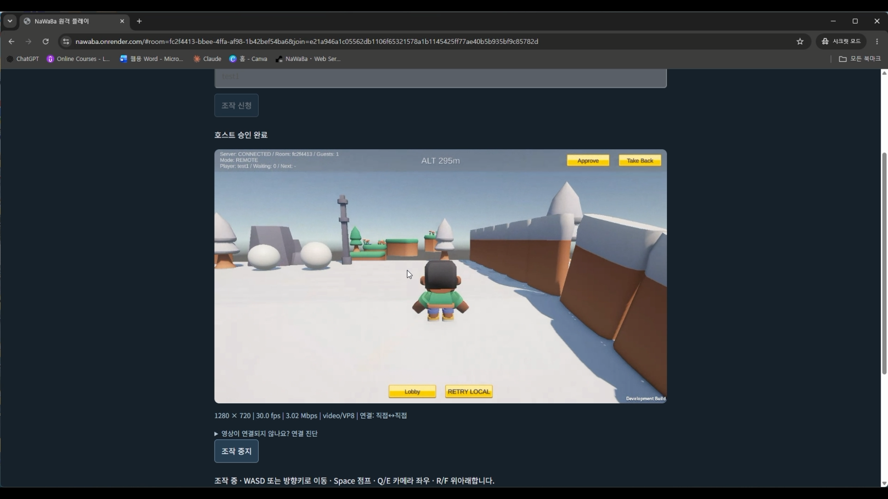
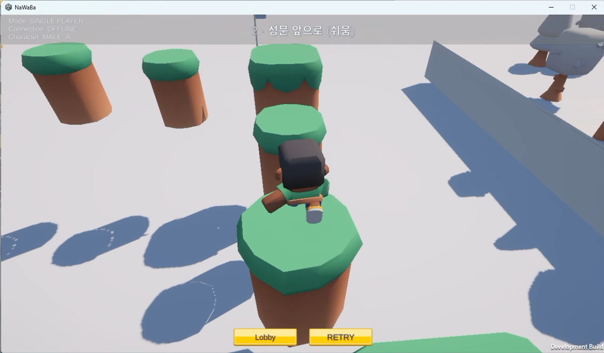
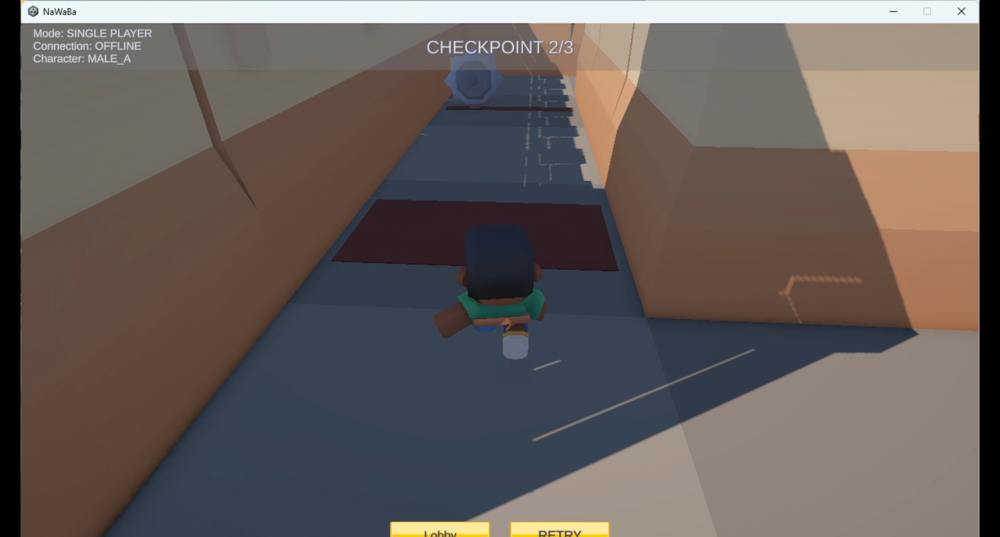
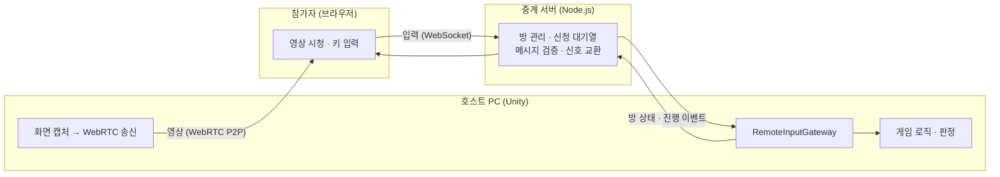

# NaWaBa (나와바)

> **"야, 나와 봐. 내가 할게."**
> 구경하던 사람이 웹 링크 하나로 들어와, 진행 중인 플레이를 그 자리에서 넘겨받는 3D 플랫포머·퍼즐 게임

<!-- TODO: 대표 GIF 1개 (교대 순간이 보이는 10초 내외) — 생기면 아래 이미지를 GIF로 교체 -->
<p align="center">
  
  <br><sub>참가자 브라우저 화면 — 호스트 게임 영상을 보며 WASD/Space로 직접 조작 (1280×720, 30fps)</sub>
</p>

| | |
|---|---|
| 장르 | 3D 플랫포머 · 퍼즐 (4 스테이지) |
| 인원 | 1인 개발 |
| 기간 | 2026.10 ~ (개발 중) |
| 엔진 | Unity 6.3 LTS (URP, Input System, TextMeshPro) |
| 네트워크 | Unity WebRTC(영상) · WebSocket(입력/신호) · Node.js 서버(Render 배포) |
| AI 도구 | Claude Code (웹 서버·WebRTC 구현), 작업 규칙은 [`CLAUDE.md`](CLAUDE.md) |
| 플레이 영상 | https://youtu.be/4Q18UrR6c8M |

---

## 1. 어떤 게임인가

게임을 옆에서 구경하다 보면 꼭 나오는 말, "아 그걸 왜 그렇게 해, 나와 봐"를 그대로 게임 규칙으로 만들었습니다.

- **호스트**만 게임을 설치·실행합니다.
- **참가자**는 초대 링크를 브라우저로 열면 끝입니다. 설치도 계정도 없습니다.
- 참가자는 호스트의 화면을 실시간 영상으로 보다가 **조작을 신청**하고, 호스트가 승인하면 **지금 그 상태 그대로** 캐릭터를 넘겨받습니다.
- 호스트는 언제든 **Take Back**으로 조작을 되찾습니다.

스테이지를 처음부터 다시 시작하지 않고 "떨어지기 직전의 그 순간"을 넘겨받는다는 점이 핵심입니다.

| ① 참가자: 링크로 들어와 조작 신청 | ② 호스트: Approve로 승인 | ③ 참가자: 영상을 보며 조작 |
|---|---|---|
|  |  |  |

### 스테이지 구성

네 스테이지는 공간이 이어져 있습니다. 앞 스테이지의 도착 지점이 다음 스테이지의 시작 지점입니다.

| # | 스테이지 | 내용 |
|---|---|---|
| 1 | 눈 비탈 | 굴러오는 눈덩이를 피해 비탈 정상까지 오르기 |
| 2 | 성문 앞으로 | 움직이는 발판을 건너 성 앞마당까지 가는 점프 코스 (긴 코스 기준 34개 구간) |
| 3 | 성문 열기 | 발판이 켜지는 순서를 기억해 밟는 기억 퍼즐 |
| 4 | 성 안 함정 복도 | 진자·가시·슬라이더·발사 함정의 타이밍을 읽고 통과 |

| 1 눈 비탈 | 2 성문 앞으로 | 3 성문 열기 | 4 성 안 함정 복도 |
|---|---|---|
|  |  |  |  |


---

## 2. 구조



- **판정은 전부 호스트 게임이 합니다.** 브라우저는 영상을 보고 입력만 보내므로, 참가자 쪽에 게임 로직이 없습니다.
- **영상은 P2P, 입력은 서버 경유**로 나눴습니다. 용량이 큰 영상은 서버를 거치지 않고, 입력은 서버가 "지금 조작권이 있는 사람이 보낸 것인지" 확인한 뒤에만 호스트로 전달합니다.
- 서버는 게임 상태를 모릅니다. 방, 참가자, 조작권만 관리합니다.

---

## 3. 구현하면서 풀었던 문제

### 3-1. 플레이 도중에 조작자를 바꾸기

**문제.** 점프 중이든 함정 앞이든, 교대하는 순간 게임이 계속 흐르면 넘겨받은 사람은 상황을 파악하기도 전에 실패합니다.

**해결.**
- 입력을 `InputRouter` 한 곳에서 받도록 하고, 캐릭터는 "로컬 입력인지 원격 입력인지" 모르게 만들었습니다. 교대는 입력원만 바꾸는 일이 됩니다.
- 교대 순간에는 `StageHandoff`가 시뮬레이션을 멈추고 카운트다운 뒤 재개합니다. 캐릭터 위치·속도, 함정 주기, 퍼즐 진행도는 그대로 유지됩니다.
- 3스테이지 기억 퍼즐은 교대 직후 **순서를 한 번 더 보여 줍니다.** 넘겨받은 사람이 앞 사람이 본 순서를 못 봤을 수 있기 때문입니다.
- 스테이지를 클리어한 원격 조작자는 씬이 바뀌어도 조작을 유지합니다. 씬 로드 사이에 조작권 정보를 세션 객체가 들고 넘어갑니다.

### 3-2. 여러 명이 동시에 신청할 때

**문제.** 참가자가 여럿이면 누가 먼저 신청했는지, 승인된 뒤 늦게 도착한 다른 사람의 입력을 어떻게 걸러낼지가 문제입니다.

**해결.**
- 서버가 신청을 **선착순 대기열**로 관리합니다.
- 승인할 때마다 조작권 ID를 새로 발급하고, 입력 메시지마다 이 ID와 보낸 사람이 일치하는지 확인합니다. 조작권을 잃은 뒤 도착한 입력은 버려집니다.
- 메시지 크기·값 범위·종류를 전부 서버에서 검증합니다.
- 이 규칙들을 **서버 테스트 60개**로 고정했습니다(신청 순서, 잘못된 조작권, 연결 끊김, 방 격리 등).

### 3-3. 맵을 코드가 아니라 데이터와 툴로 만들기

**문제.** 처음에는 실행 시점에 코드로 맵을 생성했는데, 발판 하나 옮기려 해도 코드를 고쳐야 했습니다.

**해결.**
- 코스 정보를 ScriptableObject로 분리하고, **에디터 메뉴가 씬에 실제 오브젝트를 생성**하도록 바꿨습니다. 생성 뒤에는 씬에서 손으로 옮기고 고칠 수 있습니다.
- 다시 생성할 때는 확인 창을 띄우고 Undo 한 번으로 되돌릴 수 있게 했습니다.
- 4스테이지는 글자로 그린 지도(벽·바닥·함정·체크포인트)를 읽어 복도를 만듭니다. 배치를 바꾸는 일이 텍스트 몇 줄 수정이 됩니다.
- 에셋 키트의 조각 크기를 하드코딩하지 않고 **모델 경계를 재서 배율을 계산**합니다. 조각을 교체해도 틈이 벌어지지 않습니다.
- 난이도(Easy/Normal/Hard)도 에셋 하나에 눈덩이 속도·생성 간격·코스 종류·함정 속도·퍼즐 길이·부활 방식을 모아 두었습니다.

### 3-4. 에디터에서는 되는데 빌드에서 깨지는 것들

| 증상 | 원인 | 조치 |
|---|---|---|
| 빌드에서 눈덩이·깃발이 보라색 | 런타임에 만든 기본 도형의 머티리얼이 URP 빌드에 포함되지 않음 | 빌드에 포함되는 머티리얼을 템플릿으로 두고 복제해 쓰는 `RuntimeMaterials`로 통일 |
| 한글 UI가 네모로 표시 | TMP 기본 폰트에 한글 글리프 없음 | 동적 폰트 에셋을 대체 폰트로 연결하는 에디터 메뉴 작성 |
| 씬을 고쳐도 플레이하면 원래 맵이 나옴 | 생성물이 엉뚱한 부모에 붙어 런타임이 "맵 없음"으로 판단하고 새로 생성 | 부모 지정 수정, 생성물 탐색 범위를 씬 전체로 변경 |

### 3-5. "내 PC에서는 되는데 친구 PC에서는 안 되는" 영상 연결

**문제.** 외부 테스트에서 한 명의 PC만 영상 연결이 실패했습니다. 그 PC는 참가자로도, 호스트로도, 같은 PC 안에서 접속해도 실패했습니다.

**처음에 놓친 것.** 내 PC와 외부 PC 한 대에서 영상이 나오는 것을 확인하고 다음 기능으로 넘어갔습니다. WebRTC가 연결 후보를 모으고 경로를 고르는 과정을 이해하지 못한 상태여서, 실패했을 때 어느 단계에서 멈췄는지 짚을 수 없었습니다.

**한 일.**
- 연결 과정을 단계별로 정리했습니다. 연결 후보(ICE candidate) 수집 → 후보끼리 연결 시도 → 직접 연결이 막히면 TURN 중계가 필요합니다.
- STUN 서버를 3곳으로 늘리고, 서버 환경 변수(`NAWABA_ICE_SERVERS`)로 TURN 서버를 추가할 수 있게 했습니다.
- 웹에 **연결 진단** 기능을 넣어, 참가자가 버튼 하나로 자기 환경의 후보 수집 결과를 확인할 수 있게 했습니다. 영상 아래에는 해상도·fps·비트레이트와 연결 경로(예: `연결: 직접↔직접`)가 항상 표시됩니다.
- 호스트 로그에 후보 종류 요약을 남겨, 로그 한 줄로 원인을 좁힐 수 있게 했습니다.

**현재 상태.** 같은 PC 안의 접속까지 실패한다는 점에서 네트워크보다 그 PC 자체의 UDP 차단(VPN·보안 프로그램·방화벽)으로 범위를 좁혔고, 진단 결과를 받아 확정할 예정입니다. 직접 연결이 불가능한 환경을 위해서는 TURN 서버 도입이 필요하다는 결론이며, 설정은 지원하지만 서버는 아직 두지 않았습니다.

---

## 4. 숫자로 보는 프로젝트

| 항목 | 값 |
|---|---|
| 스테이지 | 4개 (공간 연결) |
| 난이도 | 3단계, 조정 항목 16개 |
| 서버 테스트 | 60개 |
| 프로토콜 버전 | 8 (게임·서버·웹 3곳 일치 검사) |
| 맵 생성 에디터 메뉴 | 5개 |

---

## 5. AI 활용 방식

웹 서버와 WebRTC는 이 프로젝트에서 처음 다뤘습니다. 이 영역의 구현에는 Claude Code를 활용했고, 역할은 이렇게 나눴습니다.

| 직접 한 일 | Claude Code에 맡긴 일 |
|---|---|
| 게임 규칙, 스테이지 기획, 교대 방식 결정 | 중계 서버, WebRTC 영상 송신, WebSocket 입력 전달 구현 |
| Unity 에디터에서의 검증·수정·플레이 테스트 | 정해 준 범위 안의 코드 작성과 수정 |

작업은 이 순서로 진행합니다.

1. 저장소 루트의 [`CLAUDE.md`](CLAUDE.md)에 작업 규칙을 적어 둡니다. 제가 정한 게임 규칙은 "바꾸지 말 것"으로 구분하고, 검증하지 못한 항목은 따로 표시하도록 했습니다.
2. 기능 하나의 요구사항과 완료 조건을 전달하고, 수정할 파일과 작업 계획을 먼저 확인한 뒤 구현을 요청합니다.
3. 서버를 바꾸면 서버 테스트 60개가 모두 통과해야 합니다. 게임은 Unity에서, 원격 조작은 외부 PC의 브라우저에서 직접 확인합니다.
4. 완료 조건을 충족하면 커밋합니다.

3-5의 영상 연결 문제를 겪은 뒤로는, 기능마다 완료 조건과 실패 시 확인할 항목을 먼저 정하고 코드 흐름을 설명할 수 있을 때 다음 작업으로 넘어갑니다.

---

## 6. 한계와 다음 단계

- **TURN 서버 미도입** — 직접 연결이 막힌 네트워크에서는 영상이 연결되지 않습니다. (TURN 설정 자체는 지원)
- **호스트 인증이 개발용 공유 키** — 스팀 출시를 목표로, 설치한 누구나 호스트가 될 수 있도록 스팀 인증으로 바꿀 계획입니다.
- **Windows 호스트만 검증** — 맥·리눅스 빌드는 확인하지 못했습니다.
- 5스테이지는 기획 단계입니다.

---

## 7. 폴더 안내

```
Assets/Scripts/          공용 (입력 라우팅, 원격 입력 게이트웨이, 영상 송신, 스테이지 흐름, 난이도)
Assets/Scripts/Stage1~4/ 스테이지별 컨트롤러와 기믹
Assets/Editor/           맵 빌더 메뉴, 한글 폰트 설정
WebController/           중계 서버, 참가자 웹 페이지
CLAUDE.md                AI 작업 규칙
docs/screenshots/        README 이미지
```

## 사용 에셋

- [Kenney](https://kenney.nl) Platformer Kit, Castle Kit (CC0)
