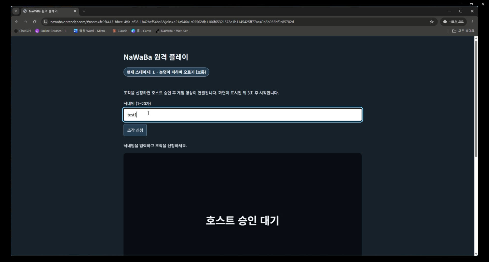
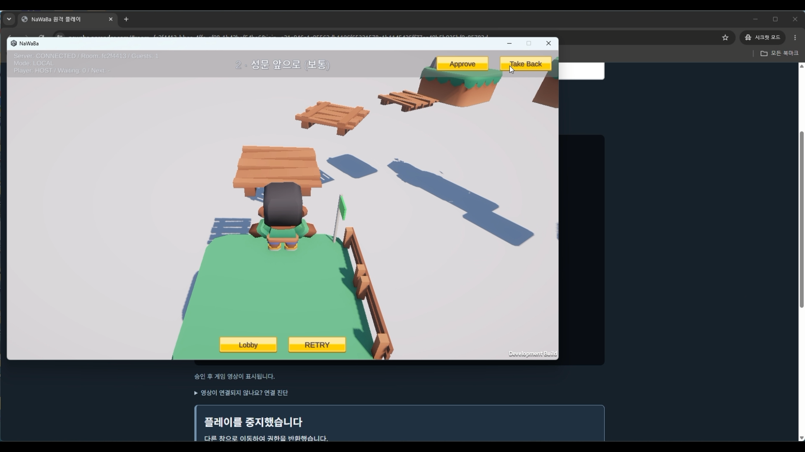
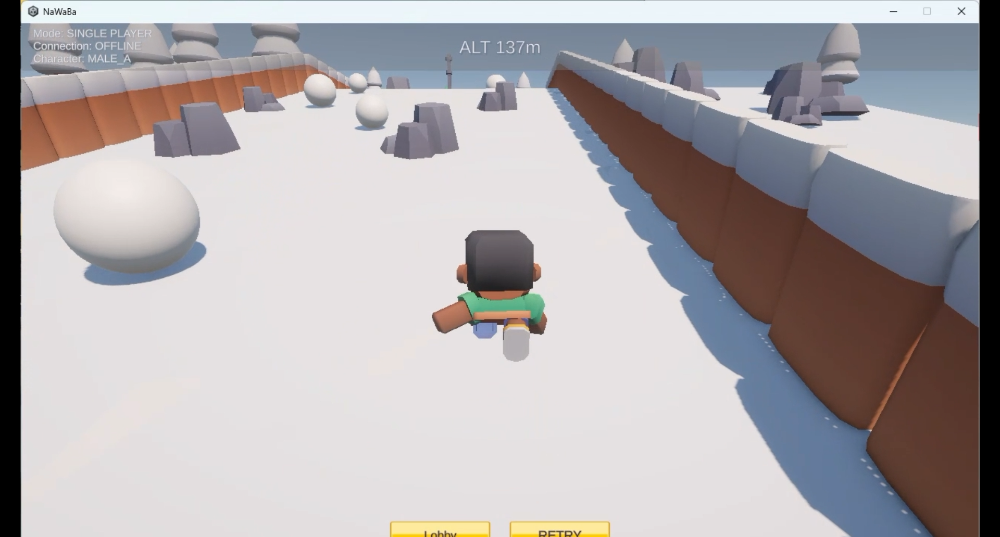
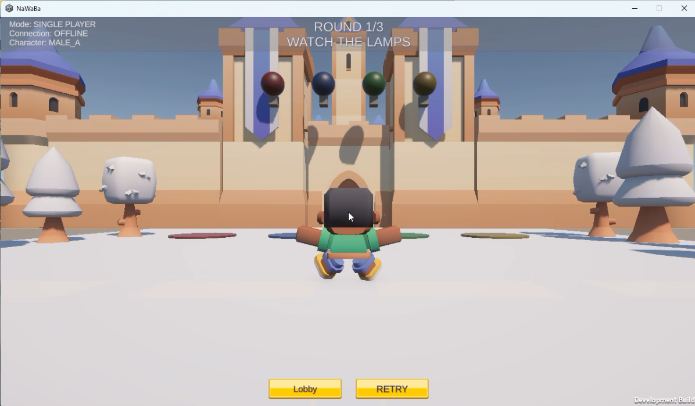
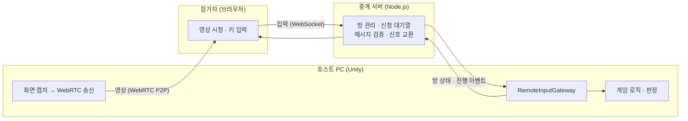

# NaWaBa (나와바)

> **"야, 나와 봐. 내가 할게."**
> 구경하던 사람이 웹 링크 하나로 들어와, 진행 중인 플레이를 그 자리에서 넘겨받는 3D 플랫포머·퍼즐 게임

<!-- TODO: 대표 GIF 1개 (교대 순간이 보이는 10초 내외) — 생기면 아래 이미지를 GIF로 교체 -->
<p align="center">
  
  <br><sub>참가자 브라우저 화면 — 호스트 게임 영상을 보며 WASD/Space로 직접 조작 (1280×720, 30fps)</sub>
</p>

| | |
|---|---|
| 장르 | 3D 플랫포머 · 퍼즐 (4 스테이지) |
| 인원 | 1인 개발 |
| 기간 | 2026.10 ~ (개발 중) |
| 엔진 | Unity 6.3 LTS (URP, Input System, TextMeshPro) |
| 네트워크 | Unity WebRTC(영상) · WebSocket(입력/신호) · Node.js 서버(Render 배포) |
| AI 도구 | Claude Code (웹 서버·WebRTC 구현), 작업 규칙은 [`CLAUDE.md`](CLAUDE.md) |
| 플레이 영상 | https://youtu.be/4Q18UrR6c8M |

---

## 1. 어떤 게임인가

게임을 옆에서 구경하다 보면 꼭 나오는 말, "아 그걸 왜 그렇게 해, 나와 봐"를 그대로 게임 규칙으로 만들었습니다.

- **호스트**만 게임을 설치·실행합니다.
- **참가자**는 초대 링크를 브라우저로 열면 끝입니다. 설치도 계정도 없습니다.
- 참가자는 호스트의 화면을 실시간 영상으로 보다가 **조작을 신청**하고, 호스트가 승인하면 **지금 그 상태 그대로** 캐릭터를 넘겨받습니다.
- 호스트는 언제든 **Take Back**으로 조작을 되찾습니다.

스테이지를 처음부터 다시 시작하지 않고 "떨어지기 직전의 그 순간"을 넘겨받는다는 점이 핵심입니다.

| ① 참가자: 링크로 들어와 조작 신청 | ② 호스트: Approve로 승인 | ③ 참가자: 영상을 보며 조작 |
|---|---|---|
|  |  |  |

### 스테이지 구성

네 스테이지는 공간이 이어져 있습니다. 앞 스테이지의 도착 지점이 다음 스테이지의 시작 지점입니다.

| # | 스테이지 | 내용 |
|---|---|---|
| 1 | 눈 비탈 | 굴러오는 눈덩이를 피해 비탈 정상까지 오르기 |
| 2 | 성문 앞으로 | 움직이는 발판을 건너 성 앞마당까지 가는 점프 코스 (긴 코스 기준 34개 구간) |
| 3 | 성문 열기 | 발판이 켜지는 순서를 기억해 밟는 기억 퍼즐 |
| 4 | 성 안 함정 복도 | 진자·가시·슬라이더·발사 함정의 타이밍을 읽고 통과 |

| 1 눈 비탈 | 2 성문 앞으로 | 3 성문 열기 | 4 성 안 함정 복도 |
|---|---|---|---|
|  |  |  |  |


---

## 2. 구조



- **판정은 전부 호스트 게임이 합니다.** 브라우저는 영상을 보고 입력만 보내므로, 참가자 쪽에 게임 로직이 없습니다.
- **영상은 P2P, 입력은 서버 경유**로 나눴습니다. 용량이 큰 영상은 서버를 거치지 않고, 입력은 서버가 "지금 조작권이 있는 사람이 보낸 것인지" 확인한 뒤에만 호스트로 전달합니다.
- 서버는 게임 상태를 모릅니다. 방, 참가자, 조작권만 관리합니다.

---

## 3. AI 활용 방식

웹 서버와 WebRTC는 이 프로젝트에서 처음 다뤘습니다. 이 영역의 구현에는 Claude Code를 활용했고, 역할은 이렇게 나눴습니다.

| 직접 한 일 | Claude Code에 맡긴 일 |
|---|---|
| 게임 규칙, 스테이지 기획, 교대 방식 결정 | 중계 서버, WebRTC 영상 송신, WebSocket 입력 전달 구현 |
| Unity 에디터에서의 검증·수정·플레이 테스트 | 정해 준 범위 안의 코드 작성과 수정 |

작업은 이 순서로 진행합니다.

1. 저장소 루트의 [`CLAUDE.md`](CLAUDE.md)에 작업 규칙을 적어 둡니다. 제가 정한 게임 규칙은 "바꾸지 말 것"으로 구분하고, 검증하지 못한 항목은 따로 표시하도록 했습니다.
2. 기능 하나의 요구사항과 완료 조건을 전달하고, 수정할 파일과 작업 계획을 먼저 확인한 뒤 구현을 요청합니다.
3. 서버를 바꾸면 서버 테스트 60개가 모두 통과해야 합니다. 게임은 Unity에서, 원격 조작은 외부 PC의 브라우저에서 직접 확인합니다.
4. 완료 조건을 충족하면 커밋합니다.

3-5의 영상 연결 문제를 겪은 뒤로는, 기능마다 완료 조건과 실패 시 확인할 항목을 먼저 정하고 코드 흐름을 설명할 수 있을 때 다음 작업으로 넘어갑니다.

---

## 4. 한계와 다음 단계

- **TURN 서버 미도입** — 직접 연결이 막힌 네트워크에서는 영상이 연결되지 않습니다. (TURN 설정 자체는 지원)
- **호스트 인증이 개발용 공유 키** — 스팀 출시를 목표로, 설치한 누구나 호스트가 될 수 있도록 스팀 인증으로 바꿀 계획입니다.
- **Windows 호스트만 검증** — 맥·리눅스 빌드는 확인하지 못했습니다.
- 5스테이지는 기획 단계입니다.

---

## 5. 폴더 안내

```
Assets/Scripts/          공용 (입력 라우팅, 원격 입력 게이트웨이, 영상 송신, 스테이지 흐름, 난이도)
Assets/Scripts/Stage1~4/ 스테이지별 컨트롤러와 기믹
Assets/Editor/           맵 빌더 메뉴, 한글 폰트 설정
WebController/           중계 서버, 참가자 웹 페이지
CLAUDE.md                AI 작업 규칙
docs/screenshots/        README 이미지
```

## 사용 에셋

- [Kenney](https://kenney.nl) Platformer Kit, Castle Kit (CC0)
